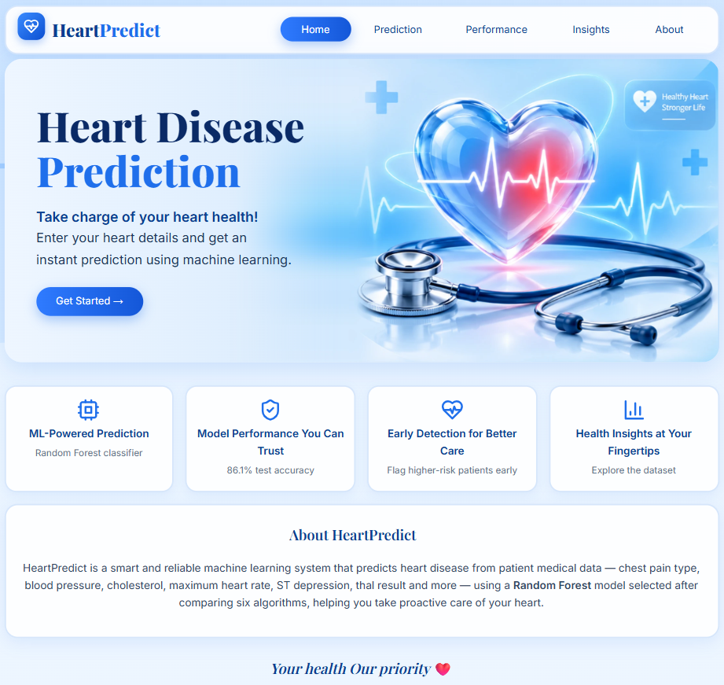
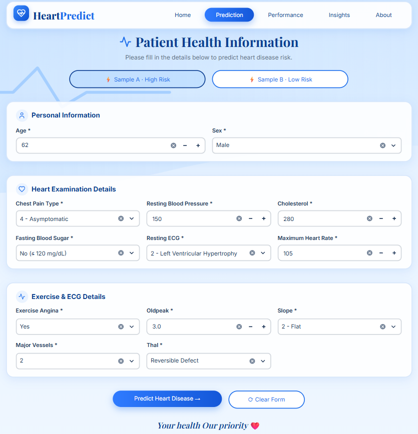
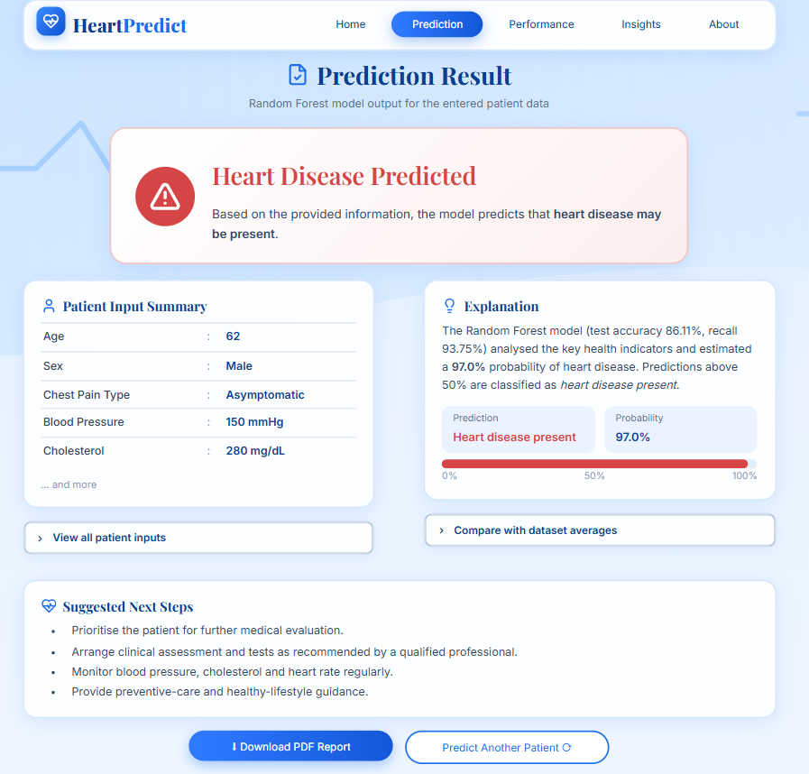
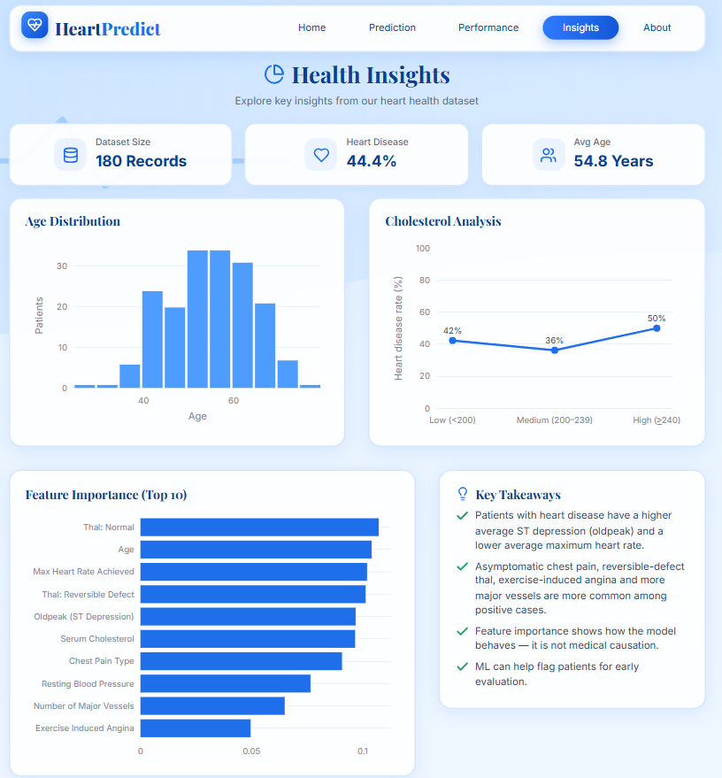
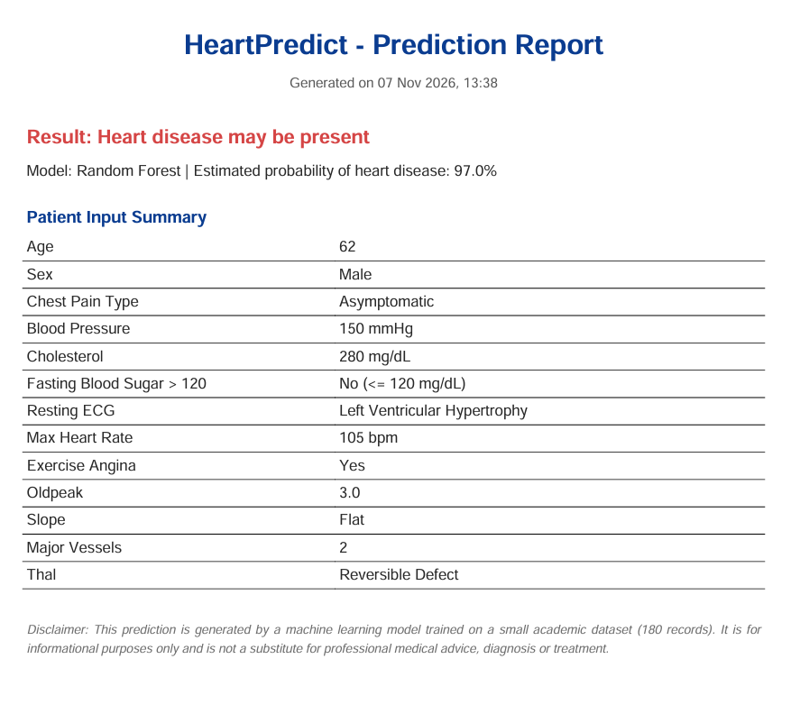

# ❤️ HeartPredict – AI-Powered Heart Disease Prediction System

A Streamlit web app that predicts whether heart disease may be present from a patient's
medical details, using a **Random Forest** model selected after comparing six machine-learning algorithms.

> ⚠️ **Disclaimer:** This is an academic decision-support tool trained on a small dataset
> (180 patients). It is **not** a substitute for professional medical advice.

## Screenshots

| Home | Prediction form |
|---|---|
|  |  |

| Prediction result | Health insights |
|---|---|
|  |  |

**Downloadable PDF report**



## Features

- **Prediction** – enter 13 clinical details and get an instant result with the model's probability
- **PDF report** – download the patient inputs and result
- **Model performance** – compare 6 algorithms, view confusion matrices
- **Health insights** – age distribution, cholesterol analysis, feature importance, key takeaways
- **Sample patients** – one-click fill (high-risk and low-risk examples) for quick testing

## Model results (20% test set, 36 patients)

| Model | Accuracy | Precision | Recall | F1 |
|---|---|---|---|---|
| Logistic Regression | 0.8333 | 0.7778 | 0.8750 | 0.8235 |
| Decision Tree | 0.8056 | 0.7647 | 0.8125 | 0.7879 |
| **Random Forest** | **0.8611** | 0.7895 | **0.9375** | **0.8571** |
| KNN | 0.8333 | 0.7778 | 0.8750 | 0.8235 |
| SVM | 0.8611 | 0.8235 | 0.8750 | 0.8485 |
| Naive Bayes | 0.8611 | 0.7895 | 0.9375 | 0.8571 |

Random Forest is tied for the highest accuracy and recall. With only 36 test records, one patient
changes accuracy by about 2.8 percentage points, so small differences should be read with care.

## ML workflow

1. Load and explore the data (`values.csv` + `labels.csv`, 180 patients)
2. Pre-process: one-hot encode `thal`, StandardScaler (for LR, KNN, SVM, Naive Bayes), 80:20 stratified split (`random_state=42`)
3. Train six models and evaluate with accuracy, precision, recall and F1
4. Select Random Forest and use it for predictions in the app

The app retrains the models on start-up from the CSV files with the same settings as the notebook,
so the numbers shown match the notebook.

## Run locally

```bash
git clone https://github.com/sindhus56/heart-disease-prediction.git
cd heart-disease-prediction
pip install -r requirements.txt
streamlit run app.py
```

## Project structure

```
├── app.py                  # Streamlit app
├── values.csv              # patient features
├── labels.csv              # heart disease labels
├── requirements.txt
├── assets/hero.webp        # home-page background image
├── .streamlit/config.toml  # light theme
├── notebook/Heart_Disease_Prediction.ipynb
└── screenshots/
```

## Tech stack

Python · Streamlit · scikit-learn · Pandas · NumPy · Plotly · fpdf2

## Author

Developed by **Sindhu S**
